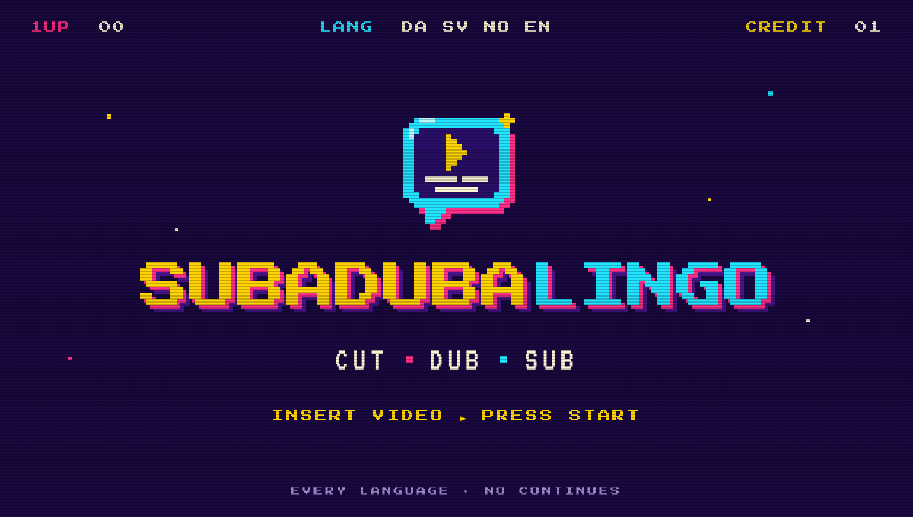

# SubaDubaLingo

A Windows app that cuts, subtitles and dubs videos, such as recorded Teams meetings and webinars, for people who are
not technical. It runs on the PC: the video never leaves it. An AI assistant of the user's choice only gets the text,
to correct it, translate it and suggest what to cut.

The app is in Danish, Swedish, Norwegian and English. Website and download: <https://subadubalingo.swaipa.dk/>.

## What it does

- **Subtitles:** speech to text with [whisper.cpp](https://github.com/ggerganov/whisper.cpp), as `.srt` files next
  to the video or burned into a new copy (size, position, box and a logo are adjustable).
- **Dubbing:** a synthetic voice in another language with [Piper](https://github.com/rhasspy/piper), one voice per
  speaker, timed sentence by sentence to the original.
- **Cutting:** long pauses, the minutes before a meeting starts, off-topic talk and filler words are suggested as
  cuts on a timeline with live picture and sound; the user decides.
- **Better sound:** an even volume and less noise in the videos the app writes.
- **Chapters and a short description** from the AI assistant.
- **A queue** of several videos, a subtitle editor, error reports and self-update.

The user picks a video, the spoken language, the new speech and the new subtitles. The app works out the rest and
reuses what it made before.

## The AI assistant

A run stops for the AI assistant's turn after the speech is written down. There are two ways through it:

- **Any AI chat** (ChatGPT, Gemini, Claude in the browser, ...): the app shows "Din tur" with three steps: copy the
  task, paste it in the chat, copy the answer back. The app notices the answer on the clipboard by itself.
- **An AI tool with MCP** (Claude desktop, Claude Code, Cursor, VS Code, Codex CLI, Gemini CLI): the app is a local
  MCP server (`SubaDubaLingo.exe --mcp`), and the assistant drives it. Settings -> "Brug med andre AI-værktøjer" shows
  the setup for each tool. A connected assistant can also take over a job started in the app.

Words the assistant corrects go into a word list, so the next transcription gets them right. Details:
[docs/assistant-panel.md](docs/assistant-panel.md), [docs/mcp-clients.md](docs/mcp-clients.md).

## Install

Download the zip from the website or the [latest release](https://github.com/swaipa46/subadubalingo/releases/latest),
unpack it and run `SubaDubaLingo.exe`. It installs itself in `%LOCALAPPDATA%\Programs\SubaDubaLingo` and updates
itself from then on. Windows may warn the first time ("Mere info" -> "Kør alligevel"), because the program is not
code signed. User guides: [docs/Sådan bruger du SubaDubaLingo.txt](docs/Sådan%20bruger%20du%20SubaDubaLingo.txt)
and the same in [English](docs/How%20to%20use%20SubaDubaLingo.txt),
[Swedish](docs/Så%20använder%20du%20SubaDubaLingo.txt) and [Norwegian](docs/Slik%20bruker%20du%20SubaDubaLingo.txt).

## Development

The app is Python 3 with Tk, packed with PyInstaller. It is Windows only; CI builds and tests it on Windows.

```
python -m venv .venv
.venv\Scripts\pip install -r requirements.txt
.\fetch-tools.ps1          # whisper.cpp, Piper and ffmpeg into bin\
.venv\Scripts\python app\main.py
.\build.ps1                # dist\SubaDubaLingo\ and dist\SubaDubaLingo <version>.zip
```

- **Code:** `app/subadubalingo/` (map in [docs/HANDOVER.md](docs/HANDOVER.md)). UI texts in
  `assets/locales/{da,sv,no,en}`; the design system in [assets/ui/README.md](assets/ui/README.md).
- **Tests:** `tests/test_*.py` are the unit tests; `tests/ci_run.py` runs them and the screenshot scripts as CI
  does (`.github/workflows/ci.yml`). Scripts that need a Whisper model run on a dev PC; the list is in
  `tests/ci_run.py`.
- **Releases:** [docs/release.md](docs/release.md); what changed: [CHANGELOG.md](CHANGELOG.md).
- **More:** [docs/technical-notes.md](docs/technical-notes.md) (design decisions and measurements),
  [docs/auto-opdatering.md](docs/auto-opdatering.md) (self-update), [docs/report-relay.md](docs/report-relay.md)
  (error reports), [docs/glossary.md](docs/glossary.md).

## Credits

The app builds on these tools and models, each under its own licence: whisper.cpp and its models (MIT), Piper and its voices (MIT
and the voices' own licences), ffmpeg (GPL build from gyan.dev), sherpa-onnx (Apache-2.0), Press Start 2P and VT323
(OFL).
